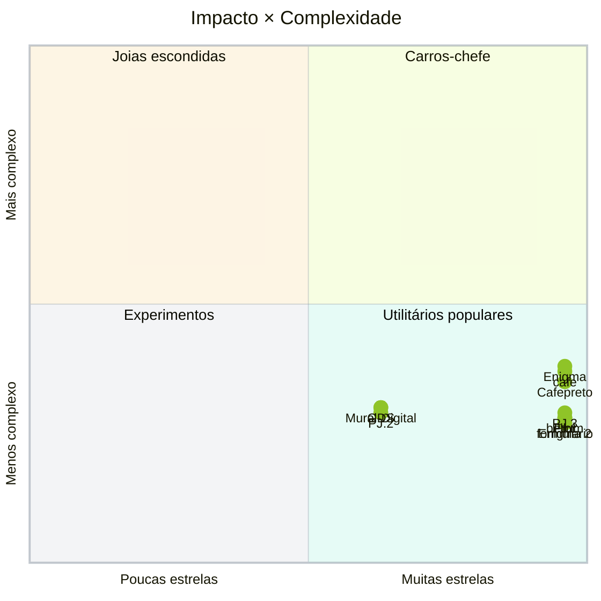
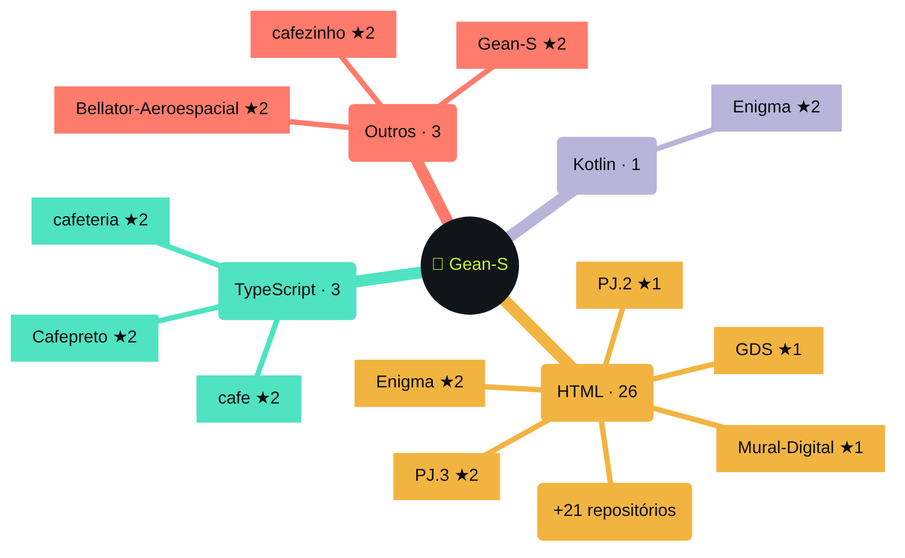

<!-- ═══════════════════════════════════════════════════════════════════
     🐐 GOATBOARD · README de perfil · @Gean-S
     Gerado em 02/09/2026 com dados reais da API do GitHub.
     As imagens estão na pasta assets/ deste repositório.
     Para atualizar os gráficos: gere um novo ZIP no GOATBOARD e envie
     README.md + assets/ por cima. Não precisa de Actions, scripts ou token.
     ═══════════════════════════════════════════════════════════════════ -->

<div align="center">

<picture>
  <source media="(prefers-color-scheme: dark)" srcset="https://raw.githubusercontent.com/Gean-S/Gean-S/HEAD/assets/hero-dark.svg">
  
</picture>

<br>

<a href="https://github.com/Gean-S?tab=repositories"></a>&nbsp;
<a href="mailto:geanoliveirasantos244@gmail.com"></a>

<sub>
<code>front-end &amp; back-end</code> · <code>design</code> · <code>manutenção de computadores</code> · <code>2h–4h de código por dia</code>
</sub>

</div>

<picture>
  <source media="(prefers-color-scheme: dark)" srcset="https://raw.githubusercontent.com/Gean-S/Gean-S/HEAD/assets/divider-dark.svg">
  <source media="(prefers-color-scheme: light)" srcset="https://raw.githubusercontent.com/Gean-S/Gean-S/HEAD/assets/divider-light.svg">
  
</picture>

## 👨‍💻 Sobre mim

Trabalho com desenvolvimento web dos dois lados: **front-end** (HTML, CSS, JavaScript, TypeScript) e **back-end** (PHP e SQL). Fora do navegador, também trabalho com **design** e **manutenção de computadores**.

Programo entre **2 e 4 horas por dia**. A maior parte dos meus repositórios são sites em HTML e CSS; também tenho trabalhos em TypeScript, Kotlin e Java. Os gráficos deste perfil são gerados a partir dos meus repositórios — e alimentam a cabra.

**Como eu trabalho**

- 🧭 &nbsp;Do layout ao banco: o mesmo projeto passa por HTML/CSS, JavaScript e PHP + SQL.
- ⏱️ &nbsp;2 a 4 horas de código por dia, todos os dias.
- 🔧 &nbsp;Software e hardware: além de programar, faço design e manutenção de computadores.

<details>
<summary>🐐 &nbsp;psst… por que uma cabra?</summary>
<br>

> Porque cabras comem qualquer coisa — inclusive backlog.
> Ela mora no meu gráfico de contribuições e come um bloco verde por commit.
> Quanto mais eu programo, mais ela come. Ninguém sabe onde vai parar.
>
> <sub><i>Ela também é a métrica de nível máximo deste perfil: <b>G.O.A.T.</b> Coincidência? Não.</i></sub>

```
   )\ /(
  ( o.o )   "todo bug é só uma feature que ainda não foi documentada"
   \ v /              — a cabra, provavelmente
    \_/🌱
```

</details>

<picture>
  <source media="(prefers-color-scheme: dark)" srcset="https://raw.githubusercontent.com/Gean-S/Gean-S/HEAD/assets/divider-dark.svg">
  <source media="(prefers-color-scheme: light)" srcset="https://raw.githubusercontent.com/Gean-S/Gean-S/HEAD/assets/divider-light.svg">
  
</picture>

## ⚡ Tecnologias

**Linguagens**

<p>


</p>

**Front-end**

<p>


</p>

**Back-end & dados**

<p>


</p>

**Outras áreas**

<p>


</p>

**Ferramentas**

<p>


</p>

<picture>
  <source media="(prefers-color-scheme: dark)" srcset="https://raw.githubusercontent.com/Gean-S/Gean-S/HEAD/assets/divider-dark.svg">
  <source media="(prefers-color-scheme: light)" srcset="https://raw.githubusercontent.com/Gean-S/Gean-S/HEAD/assets/divider-light.svg">
  
</picture>

## 📊 Meu ecossistema de projetos

<sub>Gerado a partir dos meus repositórios públicos pela API do GitHub em 02/09/2026 · nenhum número aqui é digitado à mão.</sub>

<br><br>

<p align="center">
  <picture>
    <source media="(prefers-color-scheme: dark)" srcset="https://github-readme-stats.vercel.app/api/top-langs/?username=Gean-S&layout=donut&langs_count=8&hide_border=true&bg_color=11151a&title_color=C6F432&text_color=e6ebf0&border_radius=16&locale=pt-br&card_width=440">
    <source media="(prefers-color-scheme: light)" srcset="https://github-readme-stats.vercel.app/api/top-langs/?username=Gean-S&layout=donut&langs_count=8&hide_border=true&bg_color=f6f8fa&title_color=5b8c0a&text_color=1f2328&border_radius=16&locale=pt-br&card_width=440">
    
  </picture>
  <picture>
    <source media="(prefers-color-scheme: dark)" srcset="https://raw.githubusercontent.com/Gean-S/Gean-S/HEAD/assets/tech-count-dark.svg">
    <source media="(prefers-color-scheme: light)" srcset="https://raw.githubusercontent.com/Gean-S/Gean-S/HEAD/assets/tech-count-light.svg">
    
  </picture>
</p>

<p align="center">
  <picture>
    <source media="(prefers-color-scheme: dark)" srcset="https://raw.githubusercontent.com/Gean-S/Gean-S/HEAD/assets/bubble-dark.svg">
    <source media="(prefers-color-scheme: light)" srcset="https://raw.githubusercontent.com/Gean-S/Gean-S/HEAD/assets/bubble-light.svg">
    
  </picture>
</p>

<p align="center">
  <picture>
    <source media="(prefers-color-scheme: dark)" srcset="https://raw.githubusercontent.com/Gean-S/Gean-S/HEAD/assets/radar-dark.svg">
    <source media="(prefers-color-scheme: light)" srcset="https://raw.githubusercontent.com/Gean-S/Gean-S/HEAD/assets/radar-light.svg">
    
  </picture>
  <picture>
    <source media="(prefers-color-scheme: dark)" srcset="https://raw.githubusercontent.com/Gean-S/Gean-S/HEAD/assets/commit-clock-dark.svg">
    <source media="(prefers-color-scheme: light)" srcset="https://raw.githubusercontent.com/Gean-S/Gean-S/HEAD/assets/commit-clock-light.svg">
    
  </picture>
</p>

<p align="center">
  <picture>
    <source media="(prefers-color-scheme: dark)" srcset="https://raw.githubusercontent.com/Gean-S/Gean-S/HEAD/assets/complexity-board-dark.svg">
    <source media="(prefers-color-scheme: light)" srcset="https://raw.githubusercontent.com/Gean-S/Gean-S/HEAD/assets/complexity-board-light.svg">
    
  </picture>
</p>

<p align="center">
  <picture>
    <source media="(prefers-color-scheme: dark)" srcset="https://raw.githubusercontent.com/Gean-S/Gean-S/HEAD/assets/timeline-dark.svg">
    <source media="(prefers-color-scheme: light)" srcset="https://raw.githubusercontent.com/Gean-S/Gean-S/HEAD/assets/timeline-light.svg">
    
  </picture>
</p>

<p align="center">
  <picture>
    <source media="(prefers-color-scheme: dark)" srcset="https://raw.githubusercontent.com/Gean-S/Gean-S/HEAD/assets/activity-pulse-dark.svg">
    <source media="(prefers-color-scheme: light)" srcset="https://raw.githubusercontent.com/Gean-S/Gean-S/HEAD/assets/activity-pulse-light.svg">
    
  </picture>
</p>

<p align="center">
  <picture>
    <source media="(prefers-color-scheme: dark)" srcset="https://raw.githubusercontent.com/Gean-S/Gean-S/HEAD/assets/impact-dark.svg">
    <source media="(prefers-color-scheme: light)" srcset="https://raw.githubusercontent.com/Gean-S/Gean-S/HEAD/assets/impact-light.svg">
    
  </picture>
</p>

<sub>Os dois diagramas a seguir são <b>Mermaid</b>: o GitHub renderiza nativamente, no tema da sua conta, a partir dos mesmos dados dos gráficos acima.</sub>

**Impacto × Complexidade** — <sub>cada ponto é um repositório: estrelas (escala log) no eixo x, score de complexidade no eixo y.</sub>



**Mapa do ecossistema** — <sub>repositórios agrupados pela linguagem principal, com estrelas.</sub>



<details>
<summary>🧮 &nbsp;Como a "complexidade" é calculada (e por que ela não é verdade absoluta)</summary>
<br>

É uma **estimativa relativa**, calculada a partir de fatores normalizados em escala logarítmica para 0–1:

| Fator | Fonte | Peso | Satura em |
|:--|:--|:--:|:--|
| Tamanho | tamanho do repositório na API | 20% | ~50 MB |
| Linguagens | quantidade de linguagens detectadas | 15% | 6 linguagens |
| Atividade | dias desde o último push (decai em ~8 meses) | 10% | hoje = 1 |
| Arquivos · Commits · Dependências | só disponíveis com acesso autenticado — **não entram nesta versão** | 20% · 20% · 15% | — |

`score = Σ (fator × peso) ÷ Σ (pesos disponíveis) × 100` → **SCRIPT** &lt; 25 · **APP** &lt; 50 · **SYSTEM** &lt; 75 · **PLATFORM** ≥ 75

Fatores indisponíveis são excluídos e os pesos renormalizados (aparecem como traço cinza nos gráficos). Um monorepo gigante e mal cuidado pode pontuar mais que uma biblioteca pequena e brilhante — a métrica mede *volume e movimento*, não qualidade.

</details>

<picture>
  <source media="(prefers-color-scheme: dark)" srcset="https://raw.githubusercontent.com/Gean-S/Gean-S/HEAD/assets/divider-dark.svg">
  <source media="(prefers-color-scheme: light)" srcset="https://raw.githubusercontent.com/Gean-S/Gean-S/HEAD/assets/divider-light.svg">
  
</picture>

## 🐐 Minha atividade

<sub>Calendário real dos últimos 12 meses (API do GitHub) redesenhado com a paleta do perfil. A cabra atravessa o painel comendo os blocos verdes — o gráfico oficial continua intacto logo abaixo, no meu perfil.</sub>

<br><br>

<p align="center">
  <picture>
    <source media="(prefers-color-scheme: dark)" srcset="https://raw.githubusercontent.com/Gean-S/Gean-S/HEAD/assets/goat-contributions-dark.svg">
    <source media="(prefers-color-scheme: light)" srcset="https://raw.githubusercontent.com/Gean-S/Gean-S/HEAD/assets/goat-contributions-light.svg">
    
  </picture>
</p>

<p align="center">
  <picture>
    <source media="(prefers-color-scheme: dark)" srcset="https://github-readme-activity-graph.vercel.app/graph?username=Gean-S&bg_color=11151a&color=8b96a3&line=c6f432&point=f2b441&area=true&area_color=c6f432&hide_border=true&radius=16&custom_title=Contribui%C3%A7%C3%B5es%20%E2%80%94%20%C3%BAltimos%2031%20dias">
    <source media="(prefers-color-scheme: light)" srcset="https://github-readme-activity-graph.vercel.app/graph?username=Gean-S&bg_color=f6f8fa&color=656d76&line=5b8c0a&point=b7791f&area=true&area_color=5b8c0a&hide_border=true&radius=16&custom_title=Contribui%C3%A7%C3%B5es%20%E2%80%94%20%C3%BAltimos%2031%20dias">
    
  </picture>
</p>

<picture>
  <source media="(prefers-color-scheme: dark)" srcset="https://raw.githubusercontent.com/Gean-S/Gean-S/HEAD/assets/divider-dark.svg">
  <source media="(prefers-color-scheme: light)" srcset="https://raw.githubusercontent.com/Gean-S/Gean-S/HEAD/assets/divider-light.svg">
  
</picture>

## 📈 Estatísticas

<p align="center">
  <picture>
    <source media="(prefers-color-scheme: dark)" srcset="https://github-readme-stats.vercel.app/api?username=Gean-S&show_icons=true&include_all_commits=true&rank_icon=github&hide_border=true&bg_color=11151a&title_color=C6F432&text_color=e6ebf0&icon_color=F2B441&border_radius=16&locale=pt-br&card_width=440">
    <source media="(prefers-color-scheme: light)" srcset="https://github-readme-stats.vercel.app/api?username=Gean-S&show_icons=true&include_all_commits=true&rank_icon=github&hide_border=true&bg_color=f6f8fa&title_color=5b8c0a&text_color=1f2328&icon_color=b7791f&border_radius=16&locale=pt-br&card_width=440">
    
  </picture>
  <picture>
    <source media="(prefers-color-scheme: dark)" srcset="https://streak-stats.demolab.com?user=Gean-S&hide_border=true&background=11151a&ring=C6F432&fire=F2B441&currStreakNum=E6EBF0&currStreakLabel=C6F432&sideNums=E6EBF0&sideLabels=8B96A3&dates=8B96A3&stroke=242B34&border_radius=16&locale=pt_BR&card_width=440">
    <source media="(prefers-color-scheme: light)" srcset="https://streak-stats.demolab.com?user=Gean-S&hide_border=true&background=F6F8FA&ring=5B8C0A&fire=B7791F&currStreakNum=1F2328&currStreakLabel=5B8C0A&sideNums=1F2328&sideLabels=656D76&dates=656D76&stroke=D0D7DE&border_radius=16&locale=pt_BR&card_width=440">
    
  </picture>
</p>

<picture>
  <source media="(prefers-color-scheme: dark)" srcset="https://raw.githubusercontent.com/Gean-S/Gean-S/HEAD/assets/divider-dark.svg">
  <source media="(prefers-color-scheme: light)" srcset="https://raw.githubusercontent.com/Gean-S/Gean-S/HEAD/assets/divider-light.svg">
  
</picture>

## 🚀 Projetos em destaque

<sub>Cards gerados com dados reais de cada repositório (stars, forks, linguagens, atividade e complexidade). Clique no card para abrir o projeto.</sub>

<br><br>

<p align="center">
<a href="https://github.com/Gean-S/Enigma">
<picture>
  <source media="(prefers-color-scheme: dark)" srcset="https://raw.githubusercontent.com/Gean-S/Gean-S/HEAD/assets/project-enigma-dark.svg">
  <source media="(prefers-color-scheme: light)" srcset="https://raw.githubusercontent.com/Gean-S/Gean-S/HEAD/assets/project-enigma-light.svg">
  
</picture>
</a>
<a href="https://github.com/Gean-S/cafe">
<picture>
  <source media="(prefers-color-scheme: dark)" srcset="https://raw.githubusercontent.com/Gean-S/Gean-S/HEAD/assets/project-cafe-dark.svg">
  <source media="(prefers-color-scheme: light)" srcset="https://raw.githubusercontent.com/Gean-S/Gean-S/HEAD/assets/project-cafe-light.svg">
  
</picture>
</a>
<a href="https://github.com/Gean-S/Enigma-">
<picture>
  <source media="(prefers-color-scheme: dark)" srcset="https://raw.githubusercontent.com/Gean-S/Gean-S/HEAD/assets/project-enigma-2-dark.svg">
  <source media="(prefers-color-scheme: light)" srcset="https://raw.githubusercontent.com/Gean-S/Gean-S/HEAD/assets/project-enigma-2-light.svg">
  
</picture>
</a>
<a href="https://github.com/Gean-S/bellum">
<picture>
  <source media="(prefers-color-scheme: dark)" srcset="https://raw.githubusercontent.com/Gean-S/Gean-S/HEAD/assets/project-bellum-dark.svg">
  <source media="(prefers-color-scheme: light)" srcset="https://raw.githubusercontent.com/Gean-S/Gean-S/HEAD/assets/project-bellum-light.svg">
  
</picture>
</a>
</p>

<picture>
  <source media="(prefers-color-scheme: dark)" srcset="https://raw.githubusercontent.com/Gean-S/Gean-S/HEAD/assets/divider-dark.svg">
  <source media="(prefers-color-scheme: light)" srcset="https://raw.githubusercontent.com/Gean-S/Gean-S/HEAD/assets/divider-light.svg">
  
</picture>

## 🧠 Nível de desenvolvedor

<p align="center">
  <picture>
    <source media="(prefers-color-scheme: dark)" srcset="https://raw.githubusercontent.com/Gean-S/Gean-S/HEAD/assets/level-dark.svg">
    <source media="(prefers-color-scheme: light)" srcset="https://raw.githubusercontent.com/Gean-S/Gean-S/HEAD/assets/level-light.svg">
    
  </picture>
</p>

<details>
<summary>🎮 &nbsp;Regras do jogo (métrica visual, não é ranking oficial do GitHub)</summary>
<br>

`XP = Σ peso × log₂(1 + valor)` sobre indicadores reais do perfil: commits (12m) ×12 · estrelas ×10 · pull requests ×8 · issues ×5 · seguidores ×6 · repositórios ×4 · maior sequência ×6 · contribuições (12m) ×5.
Cada **60 XP** sobe um nível. A escala logarítmica impede que uma única métrica domine.

| Lv | Título | Lv | Título |
|:--:|:--|:--:|:--|
| 01 | HELLO WORLD | 06 | REFACTOR SURGEON |
| 02 | SYNTAX EXPLORER | 07 | SYSTEM BUILDER |
| 03 | BUG WHISPERER | 08 | DISTRIBUTED ARCHITECT |
| 04 | STACK WEAVER | 09 | KERNEL SAGE |
| 05 | PIPELINE PILOT | 10 | G.O.A.T. 🐐 |

</details>

<picture>
  <source media="(prefers-color-scheme: dark)" srcset="https://raw.githubusercontent.com/Gean-S/Gean-S/HEAD/assets/divider-dark.svg">
  <source media="(prefers-color-scheme: light)" srcset="https://raw.githubusercontent.com/Gean-S/Gean-S/HEAD/assets/divider-light.svg">
  
</picture>

## 📬 Contato

<div align="center">

Estou aberto a conversas sobre **desenvolvimento web, design e manutenção de computadores**. A forma mais rápida de me encontrar:

<a href="mailto:geanoliveirasantos244@gmail.com"></a>&nbsp;
<a href="https://github.com/Gean-S"></a>

<sub><i>Prefere código a formulário? Abre uma issue em qualquer repositório meu. A cabra avisa.</i></sub>

</div>

<br>

<picture>
  <source media="(prefers-color-scheme: dark)" srcset="https://raw.githubusercontent.com/Gean-S/Gean-S/HEAD/assets/footer-dark.svg">
  <source media="(prefers-color-scheme: light)" srcset="https://raw.githubusercontent.com/Gean-S/Gean-S/HEAD/assets/footer-light.svg">
  
</picture>

<div align="center">
<sub>

&nbsp;·&nbsp; design system <code>Graphite &amp; Volt</code> &nbsp;·&nbsp; gráficos gerados com dados da API do GitHub em 02/09/2026
</sub>
</div>

<!-- ─────────────────────────────────────────────────────────────
     Easter eggs para quem lê o fonte:
     • 0x2A no canto do banner é 42. Você sabe por quê.
     • No tema escuro a cabra dorme no rodapé; no claro ela pasta.
     • A cabra atinge o nível 10 antes de você. Ela é a G.O.A.T. — literalmente.
     • "nom" aparece só nas 5 semanas com mais commits do ano.
     • O relógio de commits denuncia se você é do time da madrugada. A cabra não julga.
     • Não há JavaScript neste arquivo. Tudo que se mexe é SMIL dentro dos SVGs.
     ───────────────────────────────────────────────────────────── -->

